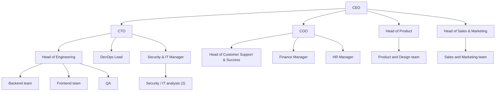

# Company Profile: Brighter (Fictional)

> Brighter is a fictional company created for a portfolio SOC 2 readiness assessment. Any resemblance to a real company is coincidental.

## 1. Overview
Brighter is a cloud-based invoicing and expense-management platform for small and mid-sized accounting firms and their business clients.

## 2. Product
- Web application (browser-based) and a public API
- Features: invoicing, expense capture, bank feed connection, client portal, reporting

## 3. Headcount and teams (about 85 people)
| Team | People |
|---|---|
| Executive / leadership | 4 |
| Engineering | 30 |
| DevOps / Infrastructure | 5 |
| Product and Design | 8 |
| Customer Support and Customer Success | 15 |
| Sales and Marketing | 12 |
| Finance, HR and Operations | 8 |
| Security / IT | 3 |

## 4. Technology stack
- Cloud: AWS (EC2, RDS PostgreSQL, S3, CloudWatch)
- Identity / SSO: Okta
- Source control and CI/CD: GitHub, GitHub Actions
- Ticketing: Jira
- Communication: Slack, Google Workspace
- Endpoints: company-issued laptops
- HR system: cloud HR platform

## 5. Customers
About 600 accounting firms and small businesses, mainly Ireland, UK and EU, with some in North America. Some customers now request a SOC 2 report in vendor security questionnaires.

## 6. Data handled
- Customer business data (invoices, expenses, client names and addresses)
- User account data (names, work emails)
- Bank-connection tokens
- Internal employee HR data
- Payment card data is NOT stored (handled by a third-party processor)

## 7. Organisation chart

