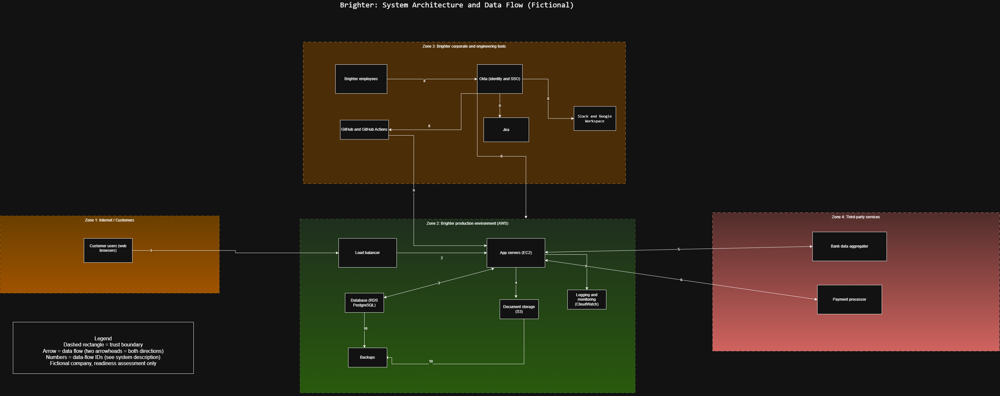
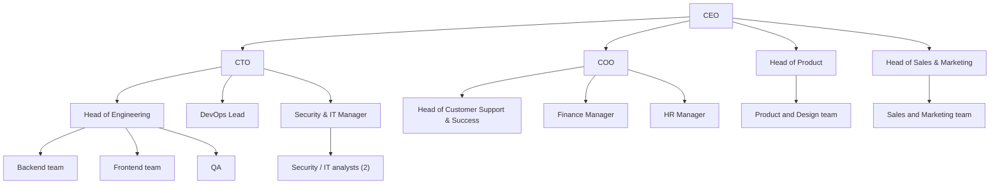

# System Description: Brighter (Fictional)

> Fictional readiness assessment. Not a SOC 2 report.

## 1. Services provided
Brighter provides a cloud-based invoicing and expense-management platform to accounting firms and their business clients, via a web application and a public API.

## 2. Service commitments and system requirements
- Availability: Brighter commits to platform availability targets in customer contracts (fictional target to be defined in the control inventory)
- Confidentiality: customer financial data and bank-connection tokens are kept confidential
- Processing integrity: invoice, expense and bank-feed data is processed completely and accurately
- Security: access to production systems and customer data is restricted to authorised personnel

## 3. System components
### 3.1 Infrastructure
Production runs on AWS: a load balancer, EC2 application servers, an RDS PostgreSQL database, S3 document storage, and CloudWatch for logs and metrics.

### 3.2 Software
Brighter web application and public API; source code in GitHub; deployments through GitHub Actions.

### 3.3 People
About 85 employees and contractors across engineering, DevOps, product, support, sales, finance/HR/operations, and a small security/IT team (see organisation chart below).

### 3.4 Data
Customer business data (invoices, expenses, client names and addresses), user account data, bank-connection tokens. Payment card data is not stored.

### 3.5 Processes and procedures
Onboarding and offboarding, access management, change management, incident response, vendor management, backup and recovery, invoice and expense processing, bank-feed imports.

## 4. Architecture diagram

## 5. Data flows
| # | From to | Description |
|---|---|---|
| 1 | Customer browser to Load balancer | Customers use the app over HTTPS |
| 2 | Load balancer to App servers | Requests forwarded to the application |
| 3 | App servers to Database | Reads and writes of invoices, expenses and accounts |
| 4 | App servers to S3 | Storage of uploaded documents |
| 5 | App servers and Bank data aggregator | Bank feed import using bank-connection tokens |
| 6 | App servers and Payment processor | Card payments handled by the processor |
| 7 | AWS components to CloudWatch | Logs and metrics |
| 8 | Employees to Okta, then to AWS console, GitHub, Jira, Slack, Google Workspace | Single sign-on for staff |
| 9 | GitHub Actions to AWS production | Code deployment |
| 10 | Database and S3 to Backups | Backup and recovery |

## 6. Organisation chart

## 7. Boundaries
In scope and out of scope: see scope.md.

## 8. Third parties (carve-out method)
AWS, Okta, GitHub, a payment processor, and a bank data aggregator. Brighter relies on these vendors; their own controls are excluded from this assessment.

## 9. Assumptions
All details are invented for this exercise.
